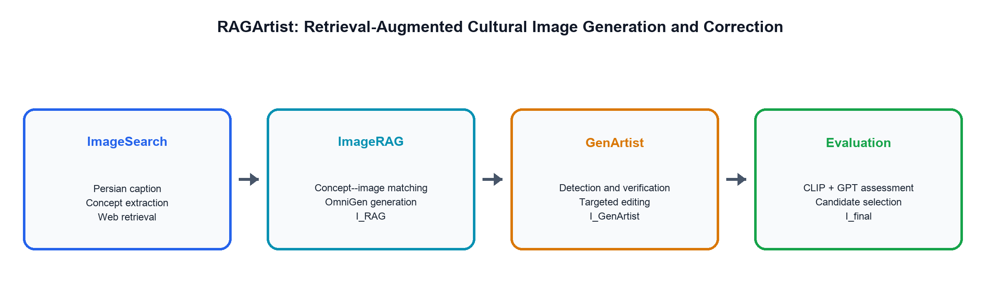

# RAGArtist

**RAGArtist** is a training-free framework for culturally grounded Persian text-to-image generation. It combines native-language image search, retrieval-conditioned generation, agentic correction, and evaluation-based candidate selection.



```text
Persian prompt
    → ImageSearch: retrieve culturally relevant references
    → ImageRAG + OmniGen: generate a grounded base image
    → GenArtist: propose targeted corrections
    → Evaluation Module: score candidates and select the final image
```

This repository is a cleaned research release of the project code and selected image runs. The scripts reflect the experimental workflow; they are **not** a single-command application. Full generation requires external model weights, upstream tool repositories, a GPU environment, and your own API credentials.

## Repository contents

| Path | Contents |
| --- | --- |
| [`code/image_search/`](code/image_search/) | Persian concept extraction and web-image retrieval scripts |
| [`code/image_rag/`](code/image_rag/) | ImageRAG retrieval, OmniGen generation, and batch orchestration |
| [`code/genartist_integration/`](code/genartist_integration/) | GenArtist integration scripts and the correction prompt templates |
| [`code/evaluation/`](code/evaluation/) | CLIP and MLLM image-evaluation script |
| [`code/analysis/`](code/analysis/) | Standard-library script for reproducing the six-metric group means |
| [`notebooks/`](notebooks/) | Original Colab research workflows, with outputs and credentials removed |
| [`Images/`](Images/) | 14 selected scene runs (109 image and metadata assets) |
| [`data/evaluations_processed.csv`](data/evaluations_processed.csv) | Processed evaluation records for the 562-prompt benchmark |

The `Images` folder is a **qualitative subset**, not the complete set of benchmark images. Its original scene names and numbered files are retained for traceability. See the [image guide](Images/README.md) and [manifest](Images/manifest.json).

## Data and evaluation

`data/evaluations_processed.csv` has 890 records for 562 unique prompts. GenArtist produced at least one correction for 327 prompts. One base-image record is duplicated in the source CSV; the analysis script uses one base row per prompt.

To print the means used for the six metrics in Figure 11, using only Python's standard library:

```bash
python code/analysis/summarize_scores.py data/evaluations_processed.csv
```

The script reports three groups: 562 ImageRAG base images, the last recorded GenArtist correction for each of 327 corrected prompts, and 562 selected final images. Since these groups have different denominators, their bar heights are descriptive; paired comparisons require matching records by prompt.

## Running the experimental pipeline

1. Set up the upstream [ImageRAG](https://github.com/rotem-shalev/ImageRAG), [OmniGen](https://github.com/VectorSpaceLab/OmniGen), and [GenArtist](https://github.com/zhenyuw16/GenArtist) projects and download the checkpoints required by their documentation. The files here under `code/image_rag/` and `code/genartist_integration/` record the versions and integration logic used in this project; they rely on those upstream packages and tool directories.
2. Create the ImageRAG environment from [`code/image_rag/environment.yml`](code/image_rag/environment.yml) on a compatible Linux/CUDA system. The search and evaluation dependencies are listed in [`code/image_search/requirements.txt`](code/image_search/requirements.txt) and [`code/evaluation/requirements.txt`](code/evaluation/requirements.txt). Install GenArtist and OmniGen according to their upstream instructions, including the appropriate PyTorch/CUDA build. The original notebooks were developed in Colab and also assume a GPU and mounted data directories.
3. Provide your own prompt spreadsheet with `id`, `Persian`, `English`, and `Persian_Concepts` columns, and set `RAGARTIST_PROMPTS_XLSX` to its path. The released evaluation CSV contains the scored benchmark prompts; it is not the input spreadsheet for the search script.
4. Set `OPENAI_API_KEY` in your environment before running code that calls an MLLM. Additional optional paths and credentials are listed in [`.env.example`](.env.example). Keep real credentials outside the repository.
5. Review the paths and batch ranges in the research notebooks and orchestration scripts for your own environment before running generation. `code/image_search/webSearch.py` also expects a locally installed ChromeDriver for browser-based search.

The image-evaluation script can use `RAGARTIST_IMAGES_DIR` for an image-run folder and `RAGARTIST_EVALUATION_CSV` for its output path. It loads CLIP and calls an MLLM, so it needs the corresponding Python packages, model downloads, and API access. The checked-in processed CSV lets you inspect the reported measurements without rerunning those services.

## Provenance

RAGArtist adapts [ImageRAG](https://github.com/rotem-shalev/ImageRAG) for reference-guided generation and uses [GenArtist](https://github.com/zhenyuw16/GenArtist) for candidate correction; [OmniGen](https://github.com/VectorSpaceLab/OmniGen) is the image generator in this experimental configuration. Follow each upstream project's license and model terms when reproducing or extending the pipeline. Pretrained weights, caches, virtual environments, downloaded web references, and the full benchmark image corpus are not included here.
